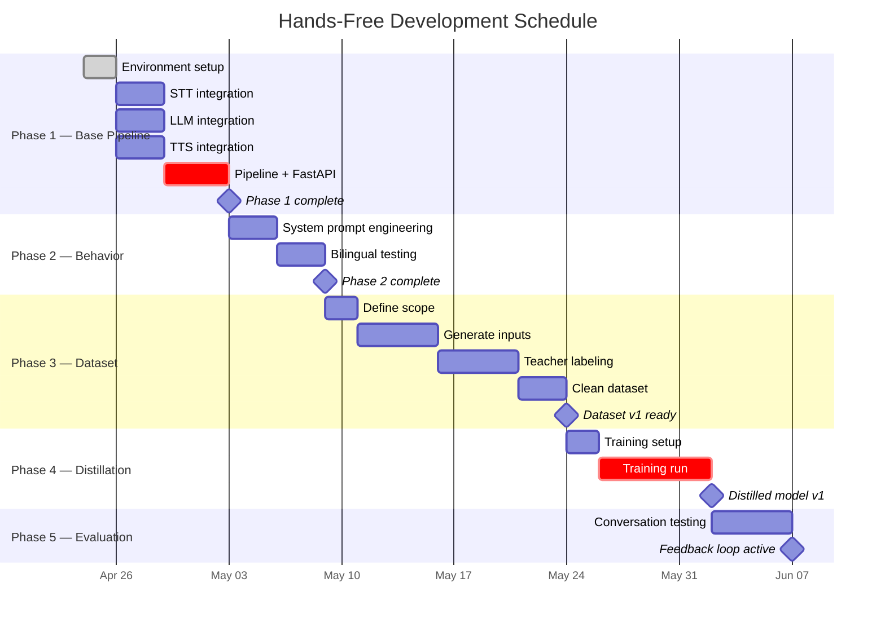

# PROJECT.md — Hands-Free: Localized Bilingual Voice-to-Voice AI

> PMBOK 7th Edition structure. Single source of truth for project status, decisions, and lessons.
> Maintained by Claude Code throughout the lifecycle.

---

## Project Identification

| Field | Value |
|---|---|
| **Project Name** | Hands-Free |
| **Project ID** | HF-2026-001 |
| **Project Manager** | Naman |
| **Sponsor / Owner** | Naman |
| **Start Date** | 2026-04-24 |
| **Planned End Date** | TBD |
| **Status** | In Progress — Windows pipeline complete; Mac setup pending |
| **Last Updated** | 2026-05-08 (distributed architecture complete; Mac deployment pending) |
| **Repository** | C:\Users\dewac\Documents\Naman\Hands-Free |

---

## Key Performance Indicators

| KPI | Current | Target |
|---|---|---|
| TTS TTFA (Fish Speech, warmed) | ~1.8s | < 0.5s (target with STT+LLM) |
| Pipeline TTFA (perceived) | ~0ms (filler hides it) | ~0ms |
| Pipeline TTFA (real, no filler) | TBD — Mac not set up yet | < 600ms |
| Bilingual accuracy (Arabic + English) | — | > 90% |
| Unit tests passing | 35 / 35 | 35 / 35 |
| Dataset samples collected | 0 | 500 (POC) → 10,000 (full) |

---

## Contents

1. [Project Charter](#1-project-charter)
2. [Scope Statement](#2-scope-statement)
3. [Work Breakdown Structure (WBS)](#3-work-breakdown-structure-wbs)
4. [Schedule & Milestones](#4-schedule--milestones)
5. [Deliverables Register](#5-deliverables-register)
6. [Cost Management](#6-cost-management)
7. [Risk Register](#7-risk-register)
8. [Issue Log](#8-issue-log)
9. [Change Log](#9-change-log)
10. [Lessons Learned](#10-lessons-learned)
11. [Current Status & Next Steps](#11-current-status--next-steps)

---

## 1. Project Charter

### 1.1 Project Purpose

Build a localized, bilingual (Arabic + English) voice-to-voice AI assistant that runs entirely on local hardware (Mac Mini). The system must handle natural conversation in both MSA and Gulf/UAE dialect Arabic, provide sub-second response latency, and progressively evolve from a raw off-the-shelf pipeline into a domain-specialized distilled model for HR and task workflows.

### 1.2 Business Objectives

- Deliver a working voice-to-voice pipeline with < 1s latency on Mac Mini hardware
- Achieve natural bilingual switching without explicit language selection by the user
- Create a reusable dataset + distillation pipeline for future specialization
- Build a system that runs fully offline with no external API dependency at inference time

### 1.3 Key Stakeholders

| Role | Name / Team | Interest |
|---|---|---|
| Sponsor | Naman | Overall system works, feels natural |
| End users | HR / office staff | Fast, accurate, conversational responses |
| Technical lead | Naman / Claude Code | Clean architecture, maintainability |

### 1.4 Success Criteria

- Voice pipeline completes STT → LLM → TTS round-trip in < 1 second (Phase 1)
- System correctly detects and responds in Arabic AND English in the same session (Phase 2)
- Distilled model outperforms raw Gemma on domain-specific queries (Phase 4)
- System runs fully offline on Mac Mini without degradation (all phases)

### 1.5 Assumptions & Constraints

| Type | Statement |
|---|---|
| Assumption | Windows (RTX A3000) handles STT + TTS; Mac Mini M4 handles LLM |
| Assumption | JAIS-2 8B Q4 GGUF available from HuggingFace (core42 or community quantization) |
| Constraint | No external API calls at inference time (privacy requirement) |
| Constraint | Quantized / small models only (Mac hardware limitation) |
| Constraint | Dataset generation for Phase 3 may use external API (OpenAI) — one-time, not at runtime |
| Constraint | Arabic: UAE/Gulf dialect preferred, fallback MSA |

---

## 2. Scope Statement

### 2.1 In Scope

| Work Package | Description |
|---|---|
| WP1: Voice Pipeline | Microphone → STT → LLM → TTS → speaker, end-to-end |
| WP2: Bilingual Behavior | Arabic + English detection and response via prompt engineering |
| WP3: Dataset Creation | Structured JSON dataset for HR + task workflows, bilingual |
| WP4: LoRA Fine-Tuning | QLoRA distillation of Gemma on generated dataset |
| WP5: Evaluation Loop | Failure capture → teacher correction → dataset update → retrain |
| WP6: Optional Enhancements | RAG, voice cloning, dialect handling, streaming |

### 2.2 Out of Scope

- Cloud deployment or multi-user serving (Phase 1–4)
- GUI beyond a simple control panel (Phase 1–2)
- Languages other than Arabic and English
- Real-time multi-speaker diarization

### 2.3 Acceptance Criteria (Definition of Done)

- All unit tests pass (`pytest`, `vitest`)
- Type checker clean (`mypy`, `tsc --noEmit`)
- Linter clean (`ruff check`, `eslint .`)
- New code has tests (golden path + one edge case)
- `CODE_STRUCTURE.md` updated to reflect current state
- Pre-push check script passes without errors

---

## 3. Work Breakdown Structure (WBS)

| WBS # | Work Package / Task | Description | Owner | Status |
|---|---|---|---|---|
| 1.0 | **Phase 1 — Windows Pipeline** | All Windows services: STT, TTS, audio, pipeline, fillers | Naman | [Complete] |
| 1.1 | Environment + requirements | requirements-shared/windows/mac/dev; .env.example | Naman | [Complete] |
| 1.2 | STT | faster-whisper large-v3-turbo CUDA; confidence gates; script validation | Naman | [Complete] |
| 1.3 | TTS | Fish Speech 1.5 in WSL2; torch.compile; voice cloning; warmup() | Naman | [Complete] |
| 1.4 | Audio capture | TEN VAD + Silero fallback; device priority; pre-roll buffering | Naman | [Complete] |
| 1.5 | Pipeline | STT→intent→filler→LLM→SentenceBuffer→TTS; 35 tests | Naman | [Complete] |
| 1.6 | Intent classifier + fillers | TF-IDF, 7 intents, bilingual; 84 filler WAVs; real Emirati+EN voices | Naman | [Complete] |
| 1.7 | LLM client + server code | llm_client.py (Windows); llm_server.py (Mac, code-complete) | Naman | [Complete] |
| 1.8 | FastAPI backend + monitoring | REST endpoints; latency_tracker; SQLite metrics | Naman | [Complete] |
| 2.0 | **Phase 2 — Mac Mini Setup** | Deploy LLM server on Mac Mini; end-to-end test | Naman | [In Progress] |
| 2.1 | Mac environment setup | Python 3.11, venv, requirements-shared + mac | Naman | [Pending] |
| 2.2 | Model download | JAIS-2 8B Q4 GGUF → ~/models/ | Naman | [Pending] |
| 2.3 | Deploy + smoke test | start_llm_server.py; curl /healthz from Windows | Naman | [Pending] |
| 2.4 | End-to-end pipeline test | Live mic → STT → LLM → TTS → speaker | Naman | [Pending] |
| 2.5 | Real latency benchmark | Measure pipeline_ttfa_ms with real services | Naman | [Pending] |
| 3.0 | **Phase 3 — Behavior Control** | Prompt tuning; Whisper initial_prompt for DEWA vocab | Naman | [Pending] |
| 3.1 | System prompt tuning | Bilingual switching, DEWA domain, short responses | Naman | [Pending] |
| 3.2 | STT domain optimization | Whisper initial_prompt with DEWA vocabulary (AR + EN) | Naman | [Pending] |
| 3.0 | **Phase 3 — Dataset Creation** | Build training dataset for distillation | Naman | [Pending] |
| 3.1 | Define query scope | HR + task workflows + conversational patterns | Naman | [Pending] |
| 3.2 | Generate inputs | English + Arabic variants, formal + dialect | Naman | [Pending] |
| 3.3 | Teacher model labeling | OpenAI API for ideal responses | Naman | [Pending] |
| 3.4 | Dataset cleaning | Remove long, robotic, inconsistent examples | Naman | [Pending] |
| 4.0 | **Phase 4 — LoRA Fine-Tuning** | Distill behavior into smaller model | Naman | [Pending] |
| 4.1 | Training setup | QLoRA config, hardware validation | Naman | [Pending] |
| 4.2 | Training run | 1–2 epochs, monitor loss | Naman | [Pending] |
| 4.3 | Merge + quantize | Merge LoRA adapters, re-quantize | Naman | [Pending] |
| 5.0 | **Phase 5 — Evaluation & Iteration** | Test, capture failures, retrain loop | Naman | [Pending] |
| 5.1 | Conversation testing | Real-world queries, failure identification | Naman | [Pending] |
| 5.2 | Feedback loop | Failure → teacher response → dataset → retrain | Naman | [Pending] |
| 6.0 | **Phase 6 — Optional Enhancements** | RAG, voice cloning, streaming | Naman | [Pending] |

**Status values:** `[Pending]` `[In Progress]` `[Complete]` `[Deferred]` `[Blocked]` `[Cancelled]`

---

## 4. Schedule & Milestones

**Planned Duration:** 2026-04-24 — TBD
**Actual Duration:** 2026-04-24 — (in progress)

### 4.1 Milestone List

| Date | Milestone | Description | Status |
|---|---|---|---|
| 2026-04-24 | Project Initiation | Scaffolding, docs, git setup | [Done] |
| 2026-04-27 | Windows Pipeline Complete | All services + 35 tests passing | [Done] |
| 2026-05-08 | Fish Speech WSL2 | torch.compile 5x speedup; voice cloning; 84 fillers; intent classifier | [Done] |
| TBD | Mac Mini LLM Live | JAIS-2 8B running; end-to-end pipeline test | [Next] |
| TBD | Phase 3 Complete | Stable bilingual behavior; DEWA vocab tuned | [Future] |
| TBD | Dataset v1 Ready | 500+ samples, cleaned | [Future] |
| TBD | Distilled Model v1 | LoRA fine-tuned model running | [Future] |
| TBD | Evaluation Loop Active | Continuous improvement cycle running | [Future] |

### 4.2 Gantt Chart

---

## 5. Deliverables Register

| ID | Deliverable | Location / Artifact | Format | Owner | Status |
|---|---|---|---|---|---|
| D1 | Project documentation | `PROJECT.md`, `CONVENTIONS.md`, `INSTRUCTIONS.md`, `CODE_STRUCTURE.md` | Markdown | Naman | [Delivered] |
| D2 | Working voice pipeline | `backend/services/pipeline.py` | Python source | Naman | [Delivered — mocked services] |
| D3 | FastAPI backend | `backend/app.py` + `backend/api/` | Python source | Naman | [Delivered] |
| D4 | Bilingual system prompt | `backend/services/prompt_builder.py` | Python source | Naman | [Delivered] |
| D5 | Training dataset v1 | `datasets/processed/v1.jsonl` | JSONL | Naman | [Planned] |
| D6 | LoRA fine-tuned model | `models/lora/hands-free-v1/` | Safetensors / GGUF | Naman | [Planned] |
| D7 | Frontend control panel | `frontend/` | Vue 3 SPA | Naman | [Planned] |

---

## 6. Cost Management

### 6.1 One-Time Costs

| Activity | Category | Cost | Basis |
|---|---|---|---|
| OpenAI API (teacher labeling, Phase 3) | API | ~$20–50 | Estimated (500–10,000 samples) |
| **Total one-time** | | **~$50** | |

### 6.2 Recurring Costs

| Component | Frequency | Per-period Cost | Monthly Estimate |
|---|---|---|---|
| Local inference | — | $0 | $0 |
| **Monthly total** | | | **$0** |

### 6.3 Infrastructure

| Item | Cost | Notes |
|---|---|---|
| Mac Mini | Existing | Primary compute, Apple Silicon Metal GPU |
| Model storage | Existing | `/Users/naman/.saltpepper/models/` |

---

## 7. Risk Register

| ID | Risk Description | Impact if Realized | Likelihood | Severity | Mitigation | Status |
|---|---|---|---|---|---|---|
| R1 | Gemma Arabic quality insufficient | Poor bilingual responses, failed Phase 2 | Medium | High | Fallback to Jais model; documented in INSTRUCTIONS.md | [Open] |
| R2 | Mac Mini too slow for real-time pipeline | Latency > 1s, poor UX | Medium | High | Profile each stage; use smallest viable models; Metal acceleration | [Open] |
| R3 | faster-whisper Arabic accuracy low | Wrong transcriptions → LLM confusion | Medium | Medium | Test with Arabic audio fixtures early; tune language param | [Open] |
| R4 | Fish Speech TTS Arabic quality poor | Unnatural Arabic speech output | Low | Medium | Evaluate early in Phase 1; swap TTS model if needed | [Open] |
| R5 | LoRA training diverges / overfits | Distilled model worse than base | Low | High | Keep 1–2 epochs; monitor loss; keep base model as fallback | [Open] |
| R6 | Dataset quality too low for distillation | Fine-tuned model has inconsistent behavior | Medium | High | Clean dataset strictly; use teacher model review step | [Open] |

---

## 8. Issue Log

| ID | Date Raised | Issue | Impact | Resolution | Status |
|---|---|---|---|---|---|
| I001 | 2026-04-24 | B001: `latency_events` table not found in standalone scripts | Benchmark fails | Call `await init_db()` before first DB write in any standalone script | [Resolved] |

> **Rule:** Never delete resolved issues. Mark resolved, keep the row.

---

## 9. Change Log

| ID | Date | Change | Reason | Impact | Approved By |
|---|---|---|---|---|---|
| C1 | 2026-04-24 | Initial project setup | Project kickoff | None | Naman |

---

## 10. Lessons Learned

| Date | Category | Lesson | Recommendation |
|---|---|---|---|
| 2026-04-24 | Architecture | FastAPI lifespan does not run in standalone scripts — any script using DB must call `init_db()` explicitly | Add `await init_db()` as first line of any standalone async main that touches the DB |
| 2026-04-24 | Tooling | `pythonjsonlogger` 3.x moved to `pythonjsonlogger.json` module — old `jsonlogger` import raises deprecation | Always check latest import path on PyPI before using third-party formatters |
| 2026-04-24 | Architecture | Sentence-level LLM→TTS pipelining is the key mechanism for "live person" feel — don't skip `SentenceBuffer` | The _MIN_SENTENCE_CHARS guard (15 chars) prevents TTS from firing on tiny fragments |

---

## 11. Current Status & Next Steps

### 11.1 Current Status (as of 2026-05-08)

> **[Green — Windows]** — All Windows services complete. 35 unit tests passing.
> Fish Speech 1.5 running in WSL2 with torch.compile (5× speedup over Windows). Voice cloning
> active with real Emirati Arabic + English reference voices. 84 filler WAVs generated.
> TF-IDF intent classifier live (7 intents, bilingual, 0.46ms inference).
>
> **[Pending — Mac]** — llm_server.py code is complete. Waiting to SSH to Mac Mini for
> first deployment: install Python 3.11 + requirements + JAIS-2 GGUF → run start_llm_server.py.
>
> **Next gate:** Mac Mini LLM server running → first end-to-end live pipeline test.

### 11.2 Work Package Progress

| Work Package | Progress | Status |
|---|---|---|
| WP1: Windows Pipeline | 8 / 8 tasks | [Complete] |
| WP2: Mac Mini Setup | 0 / 5 tasks | [In Progress — awaiting access] |
| WP3: Behavior Control | 0 / 2 tasks | [Pending] |
| WP4: Dataset Creation | 0 / 4 tasks | [Pending] |
| WP5: LoRA Fine-Tuning | 0 / 3 tasks | [Pending] |
| WP6: Evaluation Loop | 0 / 2 tasks | [Pending] |

### 11.3 Next Steps

| # | Action | Owner | Priority |
|---|---|---|---|
| 1 | SSH to Mac Mini; install Python 3.11 + brew | Naman | [Critical] |
| 2 | `git clone` repo on Mac; `pip install -r requirements-shared.txt -r requirements-mac.txt` | Naman | [Critical] |
| 3 | `CMAKE_ARGS="-DGGML_METAL=on" pip install llama-cpp-python --no-cache-dir` | Naman | [Critical] |
| 4 | Download JAIS-2 8B Q4 GGUF to `~/models/` on Mac | Naman | [Critical] |
| 5 | Create `.env` on Mac: `HF_MACHINE_ROLE=server`, `HF_LLM_MODEL_PATH`, `HF_LLM_PORT=8080` | Naman | [Critical] |
| 6 | `python scripts/start_llm_server.py` on Mac; verify `curl http://mac-mini.local:8080/healthz` | Naman | [Critical] |
| 7 | On Windows: set `HF_LLM_SERVICE_URL=http://mac-mini.local:8080`; run `python scripts/start.py` | Naman | [High] |
| 8 | Speak into mic — verify full pipeline end-to-end | Naman | [High] |
| 9 | Record real pipeline_ttfa_ms from logs; update PERFORMANCE.md | Naman | [High] |

**Priority scale:** `[Critical]` `[High]` `[Medium]` `[Low]`

### 11.4 Technology Stack

| Layer | Technology | Machine | Notes |
|---|---|---|---|
| STT | faster-whisper large-v3-turbo INT8 | Windows (CUDA) | Beam=1; EN/AR gate; confidence filters; script validation |
| VAD | TEN VAD + Silero fallback | Windows | Threshold 0.80; 600ms silence; 128ms pre-roll |
| LLM | JAIS-2 8B Q4 via llama.cpp | Mac Mini (Metal) | KV cache reuse; streaming NDJSON |
| TTS | Fish Speech 1.5 | Windows WSL2 (CUDA) | torch.compile; voice cloning; 44100Hz |
| Intent classifier | TF-IDF char n-gram | Windows | 7 intents; bilingual; 0.46ms |
| Filler audio | Pre-generated WAVs | Windows (memory) | 84 clips; instant yield from memory |
| Audio I/O | sounddevice | Windows | 16kHz capture; 44100Hz playback |
| Backend | FastAPI + Pydantic | Both | Async; SSE streaming |
| Monitoring | SQLite + structured JSON | Both | `data/metrics.db`; @track_latency |
| Frontend | None (POC) | — | Deferred to post-POC |

### 11.5 Architecture Decisions

| Date | Decision | Rationale | Alternatives Considered |
|---|---|---|---|
| 2026-04-24 | Fish Speech 1.5 for TTS | Streaming; inline prosody tags; Arabic native; voice cloning | F5-TTS (diffusion = slow), Kokoro (no Arabic), edge-tts (cloud) |
| 2026-04-24 | Sentence-level LLM→TTS pipelining | First audio plays while LLM still generating; SentenceBuffer min=8+comma = 200-500ms faster | Wait for full LLM response (adds 500ms+ latency) |
| 2026-05-05 | Fish Speech moved to WSL2 | torch.compile requires Triton (Linux only); 5× speedup: 13s→2.1s TTFA | Windows-native Fish Speech (no compile, slow) |
| 2026-05-05 | JAIS-2 8B via llama.cpp (Mac) | Arabic-English bilingual; UAE-relevant; no OpenAI dependency; llama.cpp KV cache | Ollama/Gemma (weaker Arabic), cloud LLM (privacy violation) |
| 2026-05-05 | Distributed Windows+Mac | Windows has CUDA for STT+TTS; Mac has unified memory for large LLM | Single-machine (GPU VRAM too split between models) |
| 2026-05-06 | TF-IDF intent classifier | 0.46ms inference; bilingual; no GPU; deterministic | LLM intent (adds 200ms+), keyword matching (fragile) |
| 2026-05-06 | Filler audio before real TTS | Intent-aware; yields from memory (instant); same voice as main TTS; hides pipeline latency | Silence (bad UX), generic beep (unnatural) |
| 2026-05-07 | Real voice references for cloning | Emirati Arabic + English from real MP3 sources; more natural than Edge TTS synthetic | Edge TTS synthetic (robotic cloned output) |
| 2026-05-08 | Whisper domain optimization (Phase 3) | `initial_prompt` with DEWA vocabulary; deferred until live pipeline established | Fine-tuning Whisper (expensive), API STT (privacy) |

---

## Maintenance Instructions (for Claude Code)

| Trigger | Section(s) to update |
|---|---|
| Starting work on a task | §3 WBS (mark In Progress), §11.3 Next Steps |
| Completing a phase or milestone | §3 WBS (Complete), §4 Milestones, §11.1 Status, §11.2 Progress |
| Architecture decision | §9 Change Log, §11.5 Architecture Decisions |
| Bug found | §8 Issue Log — AND — `INSTRUCTIONS.md` Bug Log |
| Bug resolved | §8 Issue Log (update), `INSTRUCTIONS.md` Bug Log (update), add regression test |
| Risk realized | §7 Risk Register (mark Realized), §8 Issue Log |
| New insight | §10 Lessons Learned |
| Every session | `Last Updated` date, §11.3 Next Steps |
