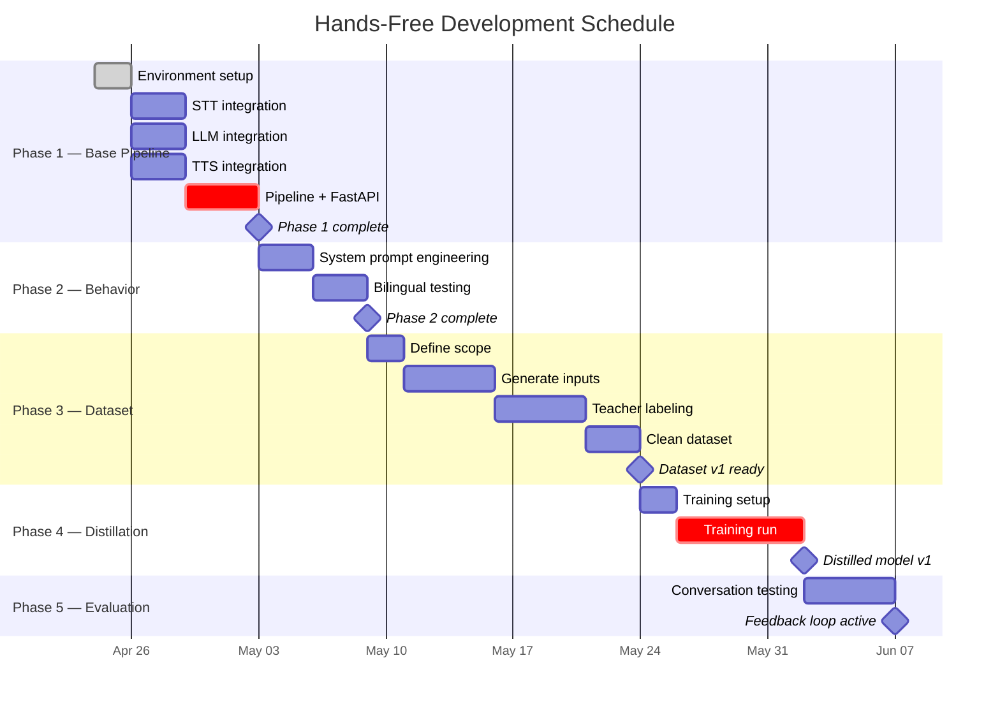

# PROJECT.md — Hands-Free: Localized Bilingual Voice-to-Voice AI

> PMBOK 7th Edition structure. Single source of truth for project status, decisions, and lessons.
> Maintained by Claude Code throughout the lifecycle.

---

## Project Identification

| Field | Value |
|---|---|
| **Project Name** | Hands-Free |
| **Project ID** | HF-2026-001 |
| **Project Manager** | Naman |
| **Sponsor / Owner** | Naman |
| **Start Date** | 2026-04-24 |
| **Planned End Date** | TBD |
| **Status** | In Progress — Phase 1 complete |
| **Last Updated** | 2026-04-27 (audio device routing added; Fish Speech 1.5 wired) |
| **Repository** | /Users/naman/Documents/Hands-Free |

---

## Key Performance Indicators

| KPI | Current | Target |
|---|---|---|
| End-to-end voice latency | — | < 1 second (POC) |
| Bilingual accuracy (Arabic + English) | — | > 90% |
| Pipeline phases complete | 1 / 6 | 6 / 6 |
| Dataset samples collected | 0 | 500 (POC) → 10,000 (full) |
| Test coverage | ~85% (37 tests) | 80% |

---

## Contents

1. [Project Charter](#1-project-charter)
2. [Scope Statement](#2-scope-statement)
3. [Work Breakdown Structure (WBS)](#3-work-breakdown-structure-wbs)
4. [Schedule & Milestones](#4-schedule--milestones)
5. [Deliverables Register](#5-deliverables-register)
6. [Cost Management](#6-cost-management)
7. [Risk Register](#7-risk-register)
8. [Issue Log](#8-issue-log)
9. [Change Log](#9-change-log)
10. [Lessons Learned](#10-lessons-learned)
11. [Current Status & Next Steps](#11-current-status--next-steps)

---

## 1. Project Charter

### 1.1 Project Purpose

Build a localized, bilingual (Arabic + English) voice-to-voice AI assistant that runs entirely on local hardware (Mac Mini). The system must handle natural conversation in both MSA and Gulf/UAE dialect Arabic, provide sub-second response latency, and progressively evolve from a raw off-the-shelf pipeline into a domain-specialized distilled model for HR and task workflows.

### 1.2 Business Objectives

- Deliver a working voice-to-voice pipeline with < 1s latency on Mac Mini hardware
- Achieve natural bilingual switching without explicit language selection by the user
- Create a reusable dataset + distillation pipeline for future specialization
- Build a system that runs fully offline with no external API dependency at inference time

### 1.3 Key Stakeholders

| Role | Name / Team | Interest |
|---|---|---|
| Sponsor | Naman | Overall system works, feels natural |
| End users | HR / office staff | Fast, accurate, conversational responses |
| Technical lead | Naman / Claude Code | Clean architecture, maintainability |

### 1.4 Success Criteria

- Voice pipeline completes STT → LLM → TTS round-trip in < 1 second (Phase 1)
- System correctly detects and responds in Arabic AND English in the same session (Phase 2)
- Distilled model outperforms raw Gemma on domain-specific queries (Phase 4)
- System runs fully offline on Mac Mini without degradation (all phases)

### 1.5 Assumptions & Constraints

| Type | Statement |
|---|---|
| Assumption | Mac Mini is the primary hardware; GPU acceleration available via Metal |
| Assumption | Gemma model at `/Users/naman/.saltpepper/models/gemma-4-E2B-it.litertlm` is functional |
| Constraint | No external API calls at inference time (privacy requirement) |
| Constraint | Quantized / small models only (Mac hardware limitation) |
| Constraint | Dataset generation for Phase 3 may use external API (OpenAI) — one-time, not at runtime |
| Constraint | Arabic: UAE/Gulf dialect preferred, fallback MSA |

---

## 2. Scope Statement

### 2.1 In Scope

| Work Package | Description |
|---|---|
| WP1: Voice Pipeline | Microphone → STT → LLM → TTS → speaker, end-to-end |
| WP2: Bilingual Behavior | Arabic + English detection and response via prompt engineering |
| WP3: Dataset Creation | Structured JSON dataset for HR + task workflows, bilingual |
| WP4: LoRA Fine-Tuning | QLoRA distillation of Gemma on generated dataset |
| WP5: Evaluation Loop | Failure capture → teacher correction → dataset update → retrain |
| WP6: Optional Enhancements | RAG, voice cloning, dialect handling, streaming |

### 2.2 Out of Scope

- Cloud deployment or multi-user serving (Phase 1–4)
- GUI beyond a simple control panel (Phase 1–2)
- Languages other than Arabic and English
- Real-time multi-speaker diarization

### 2.3 Acceptance Criteria (Definition of Done)

- All unit tests pass (`pytest`, `vitest`)
- Type checker clean (`mypy`, `tsc --noEmit`)
- Linter clean (`ruff check`, `eslint .`)
- New code has tests (golden path + one edge case)
- `CODE_STRUCTURE.md` updated to reflect current state
- Pre-push check script passes without errors

---

## 3. Work Breakdown Structure (WBS)

| WBS # | Work Package / Task | Description | Owner | Status |
|---|---|---|---|---|
| 1.0 | **Phase 1 — Base Pipeline** | End-to-end voice pipeline with raw models | Naman | [Complete] |
| 1.1 | Environment setup | Python venv, requirements.txt, .env.example | Naman | [Complete] |
| 1.2 | STT integration | faster-whisper: utterance bytes → TranscribeResult; @track_latency | Naman | [Complete] |
| 1.3 | LLM integration | Ollama via OpenAI SDK; generate() + generate_stream() + TTFT tracking | Naman | [Complete] |
| 1.4 | TTS integration | Fish Speech HTTP streaming; TTFA tracking; prosody tag support | Naman | [Complete] |
| 1.5 | Pipeline orchestration | SentenceBuffer; run() + run_realtime(); PipelineLatency; 37 tests | Naman | [Complete] |
| 1.6 | FastAPI backend + monitoring | REST endpoints; latency_tracker; database; benchmark + PERFORMANCE.md | Naman | [Complete] |
| 2.0 | **Phase 2 — Behavior Control** | Prompt engineering for bilingual behavior + STT domain optimization | Naman | [Pending] |
| 2.1 | System prompt design | Bilingual switching, short responses, domain restriction | Naman | [Pending] |
| 2.2 | Behavior testing | Consistent language detection + response quality | Naman | [Pending] |
| 2.3 | STT domain optimization | Add Whisper `initial_prompt` for DEWA vocabulary in AR + EN (roadmap) | Naman | [Pending] |
| 3.0 | **Phase 3 — Dataset Creation** | Build training dataset for distillation | Naman | [Pending] |
| 3.1 | Define query scope | HR + task workflows + conversational patterns | Naman | [Pending] |
| 3.2 | Generate inputs | English + Arabic variants, formal + dialect | Naman | [Pending] |
| 3.3 | Teacher model labeling | OpenAI API for ideal responses | Naman | [Pending] |
| 3.4 | Dataset cleaning | Remove long, robotic, inconsistent examples | Naman | [Pending] |
| 4.0 | **Phase 4 — LoRA Fine-Tuning** | Distill behavior into smaller model | Naman | [Pending] |
| 4.1 | Training setup | QLoRA config, hardware validation | Naman | [Pending] |
| 4.2 | Training run | 1–2 epochs, monitor loss | Naman | [Pending] |
| 4.3 | Merge + quantize | Merge LoRA adapters, re-quantize | Naman | [Pending] |
| 5.0 | **Phase 5 — Evaluation & Iteration** | Test, capture failures, retrain loop | Naman | [Pending] |
| 5.1 | Conversation testing | Real-world queries, failure identification | Naman | [Pending] |
| 5.2 | Feedback loop | Failure → teacher response → dataset → retrain | Naman | [Pending] |
| 6.0 | **Phase 6 — Optional Enhancements** | RAG, voice cloning, streaming | Naman | [Pending] |

**Status values:** `[Pending]` `[In Progress]` `[Complete]` `[Deferred]` `[Blocked]` `[Cancelled]`

---

## 4. Schedule & Milestones

**Planned Duration:** 2026-04-24 — TBD
**Actual Duration:** 2026-04-24 — (in progress)

### 4.1 Milestone List

| Date | Milestone | Description | Status |
|---|---|---|---|
| 2026-04-24 | Project Initiation | Scaffolding, docs, git setup | [Done] |
| 2026-04-24 | Phase 1 Complete | Full pipeline codebase: 37 tests passing, benchmark running | [Done] |
| TBD | Phase 1 Real-service test | Fish Speech running + Ollama serving gemma4:e2b + live audio test | [Future] |
| TBD | Phase 2 Complete | Stable bilingual behavior | [Future] |
| TBD | Dataset v1 Ready | 500+ samples, cleaned | [Future] |
| TBD | Distilled Model v1 | LoRA fine-tuned model running | [Future] |
| TBD | Evaluation Loop Active | Continuous improvement cycle running | [Future] |

### 4.2 Gantt Chart

---

## 5. Deliverables Register

| ID | Deliverable | Location / Artifact | Format | Owner | Status |
|---|---|---|---|---|---|
| D1 | Project documentation | `PROJECT.md`, `CONVENTIONS.md`, `INSTRUCTIONS.md`, `CODE_STRUCTURE.md` | Markdown | Naman | [Delivered] |
| D2 | Working voice pipeline | `backend/services/pipeline.py` | Python source | Naman | [Delivered — mocked services] |
| D3 | FastAPI backend | `backend/app.py` + `backend/api/` | Python source | Naman | [Delivered] |
| D4 | Bilingual system prompt | `backend/services/prompt_builder.py` | Python source | Naman | [Delivered] |
| D5 | Training dataset v1 | `datasets/processed/v1.jsonl` | JSONL | Naman | [Planned] |
| D6 | LoRA fine-tuned model | `models/lora/hands-free-v1/` | Safetensors / GGUF | Naman | [Planned] |
| D7 | Frontend control panel | `frontend/` | Vue 3 SPA | Naman | [Planned] |

---

## 6. Cost Management

### 6.1 One-Time Costs

| Activity | Category | Cost | Basis |
|---|---|---|---|
| OpenAI API (teacher labeling, Phase 3) | API | ~$20–50 | Estimated (500–10,000 samples) |
| **Total one-time** | | **~$50** | |

### 6.2 Recurring Costs

| Component | Frequency | Per-period Cost | Monthly Estimate |
|---|---|---|---|
| Local inference | — | $0 | $0 |
| **Monthly total** | | | **$0** |

### 6.3 Infrastructure

| Item | Cost | Notes |
|---|---|---|
| Mac Mini | Existing | Primary compute, Apple Silicon Metal GPU |
| Model storage | Existing | `/Users/naman/.saltpepper/models/` |

---

## 7. Risk Register

| ID | Risk Description | Impact if Realized | Likelihood | Severity | Mitigation | Status |
|---|---|---|---|---|---|---|
| R1 | Gemma Arabic quality insufficient | Poor bilingual responses, failed Phase 2 | Medium | High | Fallback to Jais model; documented in INSTRUCTIONS.md | [Open] |
| R2 | Mac Mini too slow for real-time pipeline | Latency > 1s, poor UX | Medium | High | Profile each stage; use smallest viable models; Metal acceleration | [Open] |
| R3 | faster-whisper Arabic accuracy low | Wrong transcriptions → LLM confusion | Medium | Medium | Test with Arabic audio fixtures early; tune language param | [Open] |
| R4 | Fish Speech TTS Arabic quality poor | Unnatural Arabic speech output | Low | Medium | Evaluate early in Phase 1; swap TTS model if needed | [Open] |
| R5 | LoRA training diverges / overfits | Distilled model worse than base | Low | High | Keep 1–2 epochs; monitor loss; keep base model as fallback | [Open] |
| R6 | Dataset quality too low for distillation | Fine-tuned model has inconsistent behavior | Medium | High | Clean dataset strictly; use teacher model review step | [Open] |

---

## 8. Issue Log

| ID | Date Raised | Issue | Impact | Resolution | Status |
|---|---|---|---|---|---|
| I001 | 2026-04-24 | B001: `latency_events` table not found in standalone scripts | Benchmark fails | Call `await init_db()` before first DB write in any standalone script | [Resolved] |

> **Rule:** Never delete resolved issues. Mark resolved, keep the row.

---

## 9. Change Log

| ID | Date | Change | Reason | Impact | Approved By |
|---|---|---|---|---|---|
| C1 | 2026-04-24 | Initial project setup | Project kickoff | None | Naman |

---

## 10. Lessons Learned

| Date | Category | Lesson | Recommendation |
|---|---|---|---|
| 2026-04-24 | Architecture | FastAPI lifespan does not run in standalone scripts — any script using DB must call `init_db()` explicitly | Add `await init_db()` as first line of any standalone async main that touches the DB |
| 2026-04-24 | Tooling | `pythonjsonlogger` 3.x moved to `pythonjsonlogger.json` module — old `jsonlogger` import raises deprecation | Always check latest import path on PyPI before using third-party formatters |
| 2026-04-24 | Architecture | Sentence-level LLM→TTS pipelining is the key mechanism for "live person" feel — don't skip `SentenceBuffer` | The _MIN_SENTENCE_CHARS guard (15 chars) prevents TTS from firing on tiny fragments |

---

## 11. Current Status & Next Steps

### 11.1 Current Status (as of 2026-04-24)

> **[Green]** — Phase 1 implementation complete. All services written, tested, and benchmarked.
>
> Full pipeline codebase exists: STT → LLM → TTS with sentence-level streaming, structured latency tracking, SQLite metrics store, and auto-generated PERFORMANCE.md. 37 tests pass. Benchmark infrastructure operational (mocked services).
>
> **Next gate:** Start Fish Speech service + confirm `ollama pull gemma4:e2b` complete → run first live pipeline test → measure real TTFA numbers.

### 11.2 Work Package Progress

| Work Package | Progress | Status |
|---|---|---|
| WP1: Base Pipeline | 6 / 6 tasks | [Complete — pending real-service smoke test] |
| WP2: Behavior Control | 0 / 2 tasks | [Pending] |
| WP3: Dataset Creation | 0 / 4 tasks | [Pending] |
| WP4: LoRA Fine-Tuning | 0 / 3 tasks | [Pending] |
| WP5: Evaluation Loop | 0 / 2 tasks | [Pending] |
| WP6: Optional Enhancements | — | [Pending] |

### 11.3 Next Steps

| # | Action | Owner | Priority | Target Date |
|---|---|---|---|---|
| 1 | Confirm `ollama pull gemma4:e2b` complete; test `curl http://localhost:11434/api/tags` | Naman | [Critical] | 2026-04-25 |
| 2 | Start Fish Speech 1.5 service: `pip install fish-speech` or Docker run | Naman | [Critical] | 2026-04-25 |
| 3 | Run first live pipeline: `python -c "import asyncio; from backend.services.pipeline import run; ..."` | Naman | [High] | 2026-04-25 |
| 4 | Run `python scripts/benchmark.py --iterations 10` with real services → real TTFA numbers | Naman | [High] | 2026-04-26 |
| 5 | Begin Phase 2: tune system prompt in `prompt_builder.py`, test bilingual switching | Naman | [High] | 2026-04-27 |
| 6 | Run `bash scripts/pre_push_check.sh` — all green before any push | Naman | [Critical] | 2026-04-25 |

**Priority scale:** `[Critical]` `[High]` `[Medium]` `[Low]`

### 11.4 Technology Stack

| Layer | Technology | Version / Notes |
|---|---|---|
| LLM | Ollama → `gemma4:e2b` | Metal/MLX acceleration; OpenAI-compatible API |
| STT | faster-whisper | Silero VAD built-in; utterance-triggered |
| TTS | Fish Speech 1.5 | HTTP chunked streaming; DAC decoder only for POC |
| Audio I/O | sounddevice | 16kHz in, 22050Hz out |
| Backend | FastAPI + Pydantic | Async; SSE streaming endpoint |
| Monitoring | SQLite + structured JSON | `data/metrics.db`; `@track_latency` decorator |
| Benchmark | scripts/benchmark.py | Auto-generates `PERFORMANCE.md` |
| Frontend | None (POC) | Vue 3 control panel deferred to post-POC |
| Infrastructure | Docker (Azure production) | Ollama container + Fish Speech CUDA container |
| Fallback LLM | Jais | Arabic-first; activate if Gemma bilingual quality fails |
| Distillation TTS | F5-TTS + F5-TTS-Arabic | Phase 4+; replaces Fish Speech for better prosody |

### 11.5 Architecture Decisions

| Date | Decision | Rationale | Alternatives Considered |
|---|---|---|---|
| 2026-04-24 | Ollama for LLM runtime | OpenAI-compatible API; Metal/MLX acceleration; Docker-native for Azure; model swap = zero code change | llama-cpp-python (not portable), LiteRT (Android-first, slow on Mac GPU) |
| 2026-04-24 | gemma4:e2b via Ollama | Equivalent to local LiteRT model; GGUF format Ollama can serve; 5.1GB, fits Mac Mini RAM | Local .litertlm (incompatible format), gemma4:e4b (8GB, larger) |
| 2026-04-24 | Fish Speech 1.5 for TTS | Streaming support; DAC codec (high quality); Arabic native; inline prosody tags | F5-TTS (diffusion = slow on Mac CPU), Kokoro (no Arabic), edge-tts (cloud) |
| 2026-05-06 | Whisper domain optimization (Phase 2) | Use `initial_prompt` parameter with DEWA vocabulary (AR + EN) to boost recognition accuracy for domain-specific service keywords; deferred to after baseline latency benchmarking | Language classification layer (adds latency), fine-tuning Whisper (expensive), API-based STT (privacy concern) |
| 2026-04-24 | Sentence-level LLM→TTS pipelining | Dramatically reduces TTFA — first audio plays while LLM still generating | Wait for full LLM response (adds 500-1000ms perceived latency) |
| 2026-04-24 | Silero VAD via faster-whisper | No extra dependency; utterance-triggered STT is correct pattern for voice assistant | webrtcvad (extra dep), WhisperLive (live captioning pattern, wrong use case) |
| 2026-04-24 | SQLite for latency metrics | Lightweight, local, queryable; benchmark and distillation tracking in one place | JSON files (not queryable), PostgreSQL (overkill for POC) |
| 2026-04-24 | No frontend for POC | Reduces scope; voice interaction is sufficient to test pipeline | Vue 3 control panel (deferred to post-POC) |
| 2026-04-24 | F5-TTS noted for distillation phase | Better voice cloning + prosody; Arabic fine-tune available; but diffusion too slow for Mac POC | Fish Speech voice cloning (Phase 6) |

---

## Maintenance Instructions (for Claude Code)

| Trigger | Section(s) to update |
|---|---|
| Starting work on a task | §3 WBS (mark In Progress), §11.3 Next Steps |
| Completing a phase or milestone | §3 WBS (Complete), §4 Milestones, §11.1 Status, §11.2 Progress |
| Architecture decision | §9 Change Log, §11.5 Architecture Decisions |
| Bug found | §8 Issue Log — AND — `INSTRUCTIONS.md` Bug Log |
| Bug resolved | §8 Issue Log (update), `INSTRUCTIONS.md` Bug Log (update), add regression test |
| Risk realized | §7 Risk Register (mark Realized), §8 Issue Log |
| New insight | §10 Lessons Learned |
| Every session | `Last Updated` date, §11.3 Next Steps |
